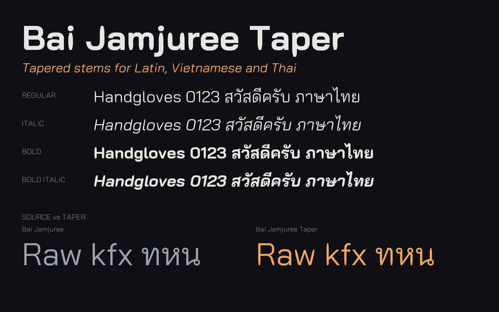

# Bai Jamjuree Taper



Bai Jamjuree by Cadson Demak, with stems that narrow toward their free ends.
Four styles: Regular, Italic, Bold and Bold Italic. Covers Latin, Vietnamese and Thai.
It stays proportional like the original.

## Build

Needs [uv](https://docs.astral.sh/uv/) (installs Python 3.11+ and fontTools from the script's inline metadata).

```sh
uv run build.py bai-jamjuree-taper.toml
```

Output: `dist/BaiJamjureeTaper/BaiJamjureeTaper-{Regular,Italic,Bold,BoldItalic}.ttf`.
Install by copying them into `~/Library/Fonts`, then pick **Bai Jamjuree Taper**.

Tune the look in `bai-jamjuree-taper.toml`: `taper.amount` (0.35 subtle, 0.5 default, 0.65 near-pointed),
`taper.length`, and `taper.max_end`.

## Download

GitHub Actions builds the fonts on every push to `main` and on pull requests.
Download them from the run's **Artifacts** section (`BaiJamjureeTaper`).
Push a tag such as `v1.0.0` to publish a Release with `BaiJamjureeTaper.zip` and the `.ttf` files attached:

```sh
git tag v1.0.0 && git push origin v1.0.0
```

## License

SIL Open Font License 1.1, see `OFL.txt`.
Copyright 2018 Bai Jamjuree (https://github.com/cadsondemak/Bai-Jamjuree).
Bai Jamjuree has no Reserved Font Name. Modifications for Bai Jamjuree Taper are released under the same license.

- Keep `OFL.txt` and the copyright notice with any copy of the fonts.
- The fonts may be bundled with software, but not sold on their own.
